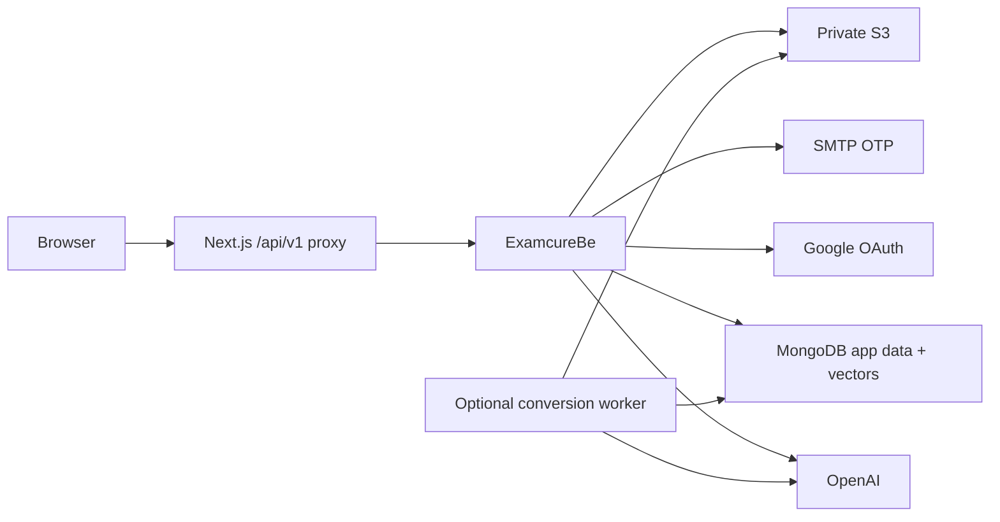

# Hạ tầng ExamcureBe

## Production

Điền các biến trong `.env.example` trên môi trường chạy API:

- `NODE_ENV=production`, JWT secret ngẫu nhiên bền vững, `DEV_EXPOSE_OTP=false`.
- `MONGODB_URI=mongodb+srv://...`, `MONGODB_DATABASE=examcure`: MongoDB Atlas hoặc
  replica set riêng. Giữ TLS và kiểm tra chứng chỉ. API/worker dùng cùng URI và
  database. API kiểm tra topology khi khởi động, từ chối standalone.
  Auth, OTP, sessions, quyền admin, môn/tài liệu, jobs, câu hỏi và đề đều lưu MongoDB.
  Transaction dùng session MongoDB driver xuyên suốt và majority write concern.
  Document khóa nghiệp vụ ngăn bootstrap/đổi quyền/version cạnh tranh sai.
- `STORAGE_DRIVER=s3`, bucket private, region, access/secret key. AWS S3 có thể
  bỏ endpoint; S3 tương thích cần endpoint. MinIO thường cần path style.
- SMTP host/user/pass/from, port và TLS đúng nhà cung cấp.
- `CORS_ORIGIN=https://<frontend>`, `API_PUBLIC_URL=https://<frontend>/api/v1`.
- FE: `NEXT_PUBLIC_API_URL=/api/v1`, `EXAMCURE_API_URL=https://<backend-origin>`.
  Rebuild FE khi đổi cấu hình. Proxy giữ cookie trên domain FE;
  `COOKIE_SAME_SITE=lax`. Gọi cross-site trực tiếp cần `none` + HTTPS nhưng
  có thể bị trình duyệt chặn third-party cookies.
- Google tùy chọn: client ID/secret và redirect URI
  `https://<frontend>/api/v1/Auth/google/callback` tại BE và Google Console.
  Client secret chỉ ở BE.
- MongoDB/OpenAI dùng các biến trong `.env.example`. Tạo vector index bằng
  `npm run setup:mongodb-vector`; dimension phải khớp model embedding.

`render.yaml` chia sẻ MongoDB/S3 của web service cho worker qua `fromService`.
Worker là tùy chọn: bỏ entry nếu chỉ cần text PPTX/DOCX; để chạy worker, đặt
`MATERIAL_PROCESSING_MODE=worker` ở API. Dockerfile worker build TypeScript
và cài LibreOffice/Poppler. Google/SMTP chỉ cần trên API.

Giới hạn upload 20 MB của API cũng phải được proxy/hosting cho phép. Nếu nền
tảng có giới hạn thấp hơn, điều chỉnh giới hạn hoặc chọn proxy phù hợp. Dùng
worker cho chuyển PDF/PNG để tránh request dài. Tạo câu hỏi AI vẫn xử lý trong
request như trước; hosting phải cho phép thời gian xử lý tương ứng.

Giữ JWT secret, backup MongoDB và bucket. SMTP/Google, S3, Atlas Search và
OpenAI cần kiểm tra bằng cấu hình thật trước cutover.

## Xác minh trước sử dụng

1. Đăng ký → OTP qua mail → xác thực → đăng nhập → reload vẫn giữ phiên.
2. Google qua callback FE; URL không chứa token.
3. Bootstrap/import admin; API cập nhật ngay khi đổi quyền.
4. Upload PPTX/DOCX → READY → xem text → tải gốc; sai dung lượng bị từ chối.
5. Sinh câu hỏi → duyệt → tạo đề; kiểm tra đúng tài liệu/môn nguồn.
6. Logout/reset: access/refresh và link tải cũ bị từ chối.

Test dùng MongoDB 8.0 replica set Docker thật. OpenAI/vector search/storage được
mock trong unit test; chưa xác nhận dịch vụ production hoặc deployment.

Tham khảo: [Render Blueprint](https://render.com/docs/blueprint-spec),
[Google OAuth](https://developers.google.com/identity/protocols/oauth2/web-server).

## MongoDB local và cấu trúc document

Chạy `docker compose up -d --wait` trong BE. `.env.example` dùng URI local với
`replicaSet=examcure-rs&directConnection=true`; dữ liệu nằm trong volume Docker.
Dùng Atlas/replica set có authentication/TLS và backup cho production.
Không chạy `docker compose down -v` nếu cần giữ dữ liệu local.

- `users`, `otp_codes`, `refresh_tokens`: tài khoản, OTP và sessions có hash.
- `subjects`, `materials`, `material_versions`, `slides`: môn, metadata và nội dung slide.
- `processing_jobs`, `generation_runs`: hàng đợi worker và lần sinh câu hỏi.
- `questions`: nhúng `question_options` và `question_sources`.
- `exams`: nhúng `exam_questions`; `audit_logs` lưu details dạng object BSON.
- `system_state`: trạng thái bootstrap một lần và khóa transaction.
- `material_chunks`: vector và nội dung trích xuất; cùng database, khác collection.

UUID/API response được giữ để FE không đổi hợp đồng. Unique indexes bảo vệ email,
Google subject, mã môn, số version, slide và refresh hash. TTL dọn OTP/session quá
hạn; API luôn tự kiểm tra expiry, không phụ thuộc thời điểm TTL chạy. Metadata giữ
ISO timestamps cho API; trường TTL là BSON Date. File PPTX/DOCX/PDF/PNG nằm trong private
S3 hoặc thư mục local, không lưu binary vào document MongoDB.

Nguồn: [MongoDB transactions](https://www.mongodb.com/docs/drivers/node/current/crud/transactions/).
